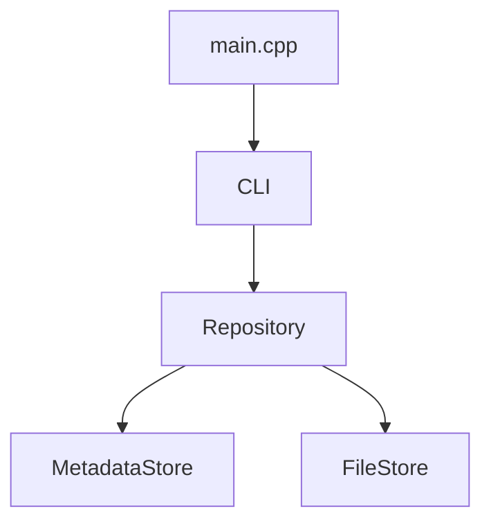

# Структура VCS Lite

Документ описывает каркас реализации. Обязательные требования находятся
в [SRS](../VCS_Lite_SRS.pdf). Методы хранения и управления версиями пока
не реализованы; их заглушки намеренно завершаются ошибкой.

## Разделение ответственности

| Модуль | Отвечает за | Не принимает на себя |
| --- | --- | --- |
| `main.cpp` | Передачу аргументов и потоков в CLI, код выхода | Логику команд и файловые операции |
| `CLI` | Синтаксис команд, справку, вывод результатов и ошибок | Прямое чтение или изменение снимков |
| `Repository` | Порядок действий, правила истории, публикацию версии и обновление HEAD | Разбор JSON и побайтовое копирование |
| `MetadataStore` | Чтение и запись state.json и meta.json, проверку метаданных | Копирование содержимого рабочих файлов |
| `FileStore` | Обход, сравнение, проверку путей и лимитов, копирование, восстановление и откат | Решение о допустимости нового коммита в истории |
| `types.hpp` | Общие структуры результатов и данных, числовые лимиты | Доступ к диску и вывод в терминал |
| `error.hpp` | Общие типы ошибок | Вывод ошибок и управление восстановлением |

## Связи модулей

`Repository` содержит экземпляры `MetadataStore` и `FileStore`. Методы CLI
получают уже подготовленные результаты и выводят их. `MetadataStore`
выделен из ответственности Repository для отдельной работы с JSON;
это уточнение проектной диаграммы классов в SRS.

## Файлы исходного кода

| Интерфейс | Реализация | Основной владелец |
| --- | --- | --- |
| `include/vcslite/cli.hpp` | `src/cli.cpp`, `src/main.cpp` | Участник 1, macOS |
| `include/vcslite/repository.hpp` | `src/repository.cpp` | Участник 1, macOS |
| `include/vcslite/metadata_store.hpp` | `src/metadata_store.cpp` | Участник 1, macOS |
| `include/vcslite/file_store.hpp` | `src/file_store.cpp` | Участник 2, Windows |
| `include/vcslite/types.hpp` | Структуры определены в заголовке | Совместное согласование |
| `include/vcslite/error.hpp` | Типы определены в заголовке | Совместное согласование |

Владение модулем означает ответственность за его реализацию и проверки.
Windows-специфичный приём Unicode-аргументов относится к CLI и согласуется
участниками при реализации поддержки кириллицы. Проверка junction/reparse
point относится к FileStore и участнику 2.

## CMake

В корне `CMakeLists.txt` объявляет проект, C++17 и подключает каталоги исходников
и тестов. `src/CMakeLists.txt` описывает три цели:

| Цель | Тип | Зависимости |
| --- | --- | --- |
| `vcslite_core` | Статическая библиотека | Стандартная библиотека C++ |
| `vcslite_cli` | Статическая библиотека | `vcslite_core` |
| `vcslite` | Исполняемая программа | `vcslite_cli` |

`vcslite_core` передаёт потребителям каталог общих заголовков и требование
C++17. Для MSVC включены `/W4`, `/utf-8`, `/permissive-`; для Clang/GCC -
`-Wall`, `-Wextra`, `-Wpedantic`. Пути в конфигурации сборки не привязаны к
компьютеру одного из разработчиков. Сборка выполняется в отдельном каталоге.

`include(CTest)` добавляет опцию `BUILD_TESTING`, по умолчанию включённую.
`tests/CMakeLists.txt` регистрирует два начальных теста. Правило `install`
устанавливает только исполняемую программу в `bin` относительно выбранного
префикса. Внешних зависимостей у каркаса пока нет.

## Типовой сценарий после реализации

Для commit CLI передаёт сообщение в Repository. Repository проверяет
положение HEAD и состояние папки, поручает FileStore запись временного снимка,
а MetadataStore - запись его описания. Затем публикует готовый каталог коммита
и обновляет состояние. При обрабатываемой ошибке публикации новый коммит
убирается из доступной истории, прежнее состояние сохраняется.

Для checkout Repository проверяет ID и состояние папки, FileStore проверяет
целевой снимок и создаёт резервную копию. Только затем начинается замена
файлов. При ошибке, в том числе при записи нового HEAD, Repository вызывает
FileStore::rollback. После --force сохранённая копия остаётся доступной.

Точные контракты описаны в [contracts.md](contracts.md).
